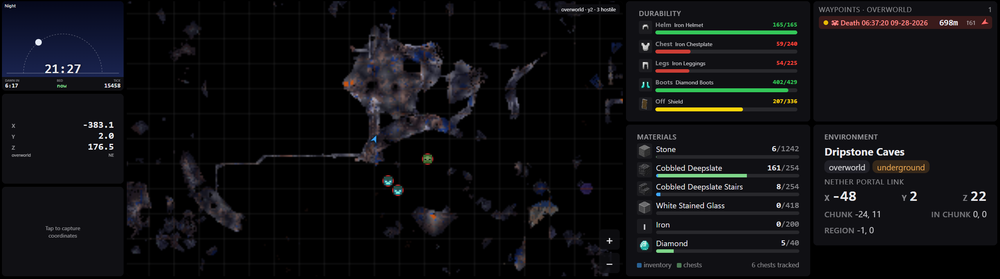

# Minecraft → Secondary Monitor

A live Minecraft dashboard for a second screen: map, coordinates, clock,
gear, effects, waypoints and more, arranged by dragging panels around on the
screen itself. It runs in a kiosk browser window on any monitor (touch or
not), fed by the [JourneyMap](https://modrinth.com/mod/journeymap) webmap API
and a small client mod of its own. Works with solo worlds **and Realms**, on
any Minecraft version JourneyMap supports (Fabric; currently 26.3).

The project started as a HUD for the Corsair Xeneon Edge, the 2560 × 720
touchscreen, and that is still its natural home: tap-driven widgets, a focus
guard so taps never steal the game's input, and iCUE widget packaging. Since
then the layout became screen-independent, so the same widgets fill a 16:9
monitor, a tablet-sized display or anything else.



*Night, underground in a dripstone cave: the clock says the bed works now, the map
has switched to the cave layer and shows three hostiles nearby, the chestplate and
leggings are in the red, and the build project counts six tracked chests.*

## Widgets

Add any of these from the **＋ Add widget** menu; each has its own settings
form. The ones marked *mod* read the bridge mod (setup step 2); the rest only
need JourneyMap. Full parameter reference:
[dashboard/README.md](dashboard/README.md#widgets).

**Map & navigation**

| Widget | What it shows |
|---|---|
| **Live map** | JourneyMap centered on you with the radar drawn on it: hostile mobs, animals, villagers, other players, your waypoints. Auto-switches to the night and cave layers. Optional trail of your path and a fixed-center "base cam" mode. |
| **Coordinates** | X / Y / Z, dimension and facing, live. |
| **Coordinates (tap)** | Stores your position when tapped (or with **H** in game, *mod*) so you can pin a portal or a hole and keep moving. |
| **Waypoints** | Your JourneyMap waypoints by distance, with height difference and an arrow relative to where you face; death points pinned in red. |
| **Threats** | The radar's hostiles as a sorted list: what, how far, which way. |

**Inventory & gear**

| Widget | What it shows |
|---|---|
| **Armor durability** *(mod)* | Bars for helmet, chestplate, leggings, boots, off hand and optionally the held tool, green → red. |
| **Materials** *(mod)* | A build's shopping list with have/need per item, counting your inventory plus the chests you placed or claimed. |
| **Inventory** *(mod)* | All 36 slots as a grid with counts and durability, and how many are free. |
| **XP & enchanting** *(mod)* | Level, progress, lapis on hand, highlight at your target level. |
| **Flight** *(mod)* | Elytra durability, rockets, altitude, speed, climb rate and heading. |

**Status**

| Widget | What it shows |
|---|---|
| **Day / night clock** | In-game time on a sun/moon arc, countdown to nightfall or dawn, when the bed works. |
| **Environment** | Biome, the Nether/Overworld portal link for where you stand, chunk and region. |
| **Effects** *(mod)* | Potion effects with countdown bars; warns before Fire Resistance, Water Breathing or Slow Falling run out. |
| **Death recovery** *(mod)* | Where you last died, distance and direction, and a countdown until the dropped items despawn. |
| **Light & spawn risk** *(mod)* | Light level where you stand, whether mobs can spawn there, weather and moon phase. |
| **Day counter** *(mod)* | World day number, session play time, real clock. |
| **Connection** *(mod)* | Ping to the server or Realm, and FPS. |

**Tools**

| Widget | What it shows |
|---|---|
| **Quick actions** *(mod)* | Big buttons that act in game: press a key (JourneyMap's **B** for a waypoint), send a chat line, capture coordinates, screenshot. |
| **Timers** | Tap-to-start countdowns and a stopwatch for smelting, brewing, crops. |
| **Checklist** | Steps to tick off; ticks are remembered. |

Plus **Web page** (any URL in a panel) and **Empty panel**. The same widget can
be added more than once with different settings, and every widget has a text
size setting.

## Arranging the screen

Tap the dim **⚙** in the bottom-left corner of the dashboard:

- **Drag** a panel to move it, drag its striped corner to resize. Panels snap
  to a grid and cannot overlap.
- **⚙** on a panel opens its settings; **✕** removes it. **＋ Add widget** adds one.
- **Screen** sets the grid, colors and data sources, lists your saved
  layouts, and moves the dashboard to another monitor with a tap.
- **Done** leaves edit mode and offers to save the arrangement under a name.

Changes are saved as you make them, per monitor, and survive restarts. Named
layouts are files in `dashboard/layouts/` (two samples are included);
[dashboard/config.js](dashboard/config.js) is the starting layout and what
"Reset" returns to. Everything in detail: [dashboard/README.md](dashboard/README.md).

## Setup

### What you need

- **Windows 11** (10 works too) and **PowerShell**. Everything below is PowerShell
  scripts run from the repo folder; no admin rights needed.
- **Minecraft: Java Edition** installed through the official launcher, started
  at least once (that creates `%APPDATA%\.minecraft`). Any game version that
  JourneyMap has a build for works
  ([its version list](https://modrinth.com/mod/journeymap/versions)); the
  newest release usually qualifies within days.
- **Fabric is required** — every widget reads JourneyMap, which is a mod — but
  `setup.ps1` installs it as an extra profile in the official launcher; your
  vanilla profile and worlds stay as they are. Forge/NeoForge are not supported.
- **Internet access** during setup: the scripts download the Fabric installer,
  a JDK, and the mods from Modrinth and Mojang. Nothing is downloaded while you play.
- A **second monitor**, touchscreen or not. The dashboard is a browser window
  (Edge, which Windows ships, or Chrome).

You do *not* need to install Java, Fabric, JourneyMap or any other mod
yourself; `setup.ps1` does all of it, into `tools\` inside the repo and the
normal `.minecraft` folders, and never touches mods it did not install.

### Quick start

```powershell
git clone https://github.com/slaskows/minecraft-dashboard.git
cd minecraft-dashboard
.\scripts\setup.ps1
```

`setup.ps1` is idempotent: it does only what is missing and can be re-run any
time (after a Minecraft update, after moving the repo). In order it:

1. **Picks the Minecraft version** — the newest Fabric profile you already
   have, otherwise the latest release (`-McVersion 26.3` to choose), and
   checks JourneyMap exists for it.
2. **Gets a JDK 25** into `tools\` if you have none (Fabric's build tooling
   needs it; ~200 MB, once).
3. **Installs the Fabric loader** profile with the official Fabric installer.
   It shows up in the Minecraft Launcher as `fabric-loader-<version>`.
4. **Installs the mods** from Modrinth: Fabric API, JourneyMap, JourneyMap
   WebMap, and a borderless-fullscreen mod (so a stolen focus can never
   minimize the game). Sets `pauseOnLostFocus:false` so solo worlds keep
   running while you tap the dashboard.
5. **Builds and installs the bridge mod** from `mod/`, pinned to the exact
   Minecraft / Fabric / Fabric API versions it just installed.
6. **Opens the dashboard** on your second monitor.

Then it tells you what is left, which is always the same two things:

- **Play once.** In the launcher select the `fabric-loader-…` profile, start
  the game and join a world. JourneyMap writes its config on this first
  launch.
- **Run `.\scripts\setup.ps1` once more.** It now finds that config and pins
  JourneyMap's webmap to port 8080, which every widget reads. From then on
  nothing else is needed; the panels light up whenever you are in a world.

Options: `-Autostart` registers the dashboard (and, for a touchscreen, the
focus guard) as logon tasks; `-NoDashboard` skips opening it;
`-MinecraftDir <path>` for a non-standard install.

In game, keep JourneyMap's radar on (**J → Options → Radar**: mobs, animals,
villagers, players); the map and the Threats widget only see what the radar
reports. Use the borderless toggle in Minecraft's video settings rather than
vanilla fullscreen.

### After a Minecraft update

Run `.\scripts\setup.ps1` again. It installs Fabric for the new version,
fetches the matching mods and rebuilds the bridge mod. If JourneyMap has no
build for the new version yet the script says so; play the previous version
(`-McVersion <previous>`) until it does.

### Touchscreen setup (Xeneon Edge and similar)

Taps on a touchscreen are real Windows input, so without help a tap would
steal focus from the game. `setup.ps1 -Autostart` (or
`.\scripts\install-tasks.ps1` on its own) registers `focus-guard.ps1` as a
hidden logon task: it hands focus straight back to Minecraft and returns the
cursor, so the widget gets the tap and the game never loses input. The guard
currently watches the 32:9 monitor (the Edge). Remove with `-Uninstall`.

On a Xeneon Edge, turn **off "Show iCUE Widgets"** in iCUE first so the Edge
acts as a normal 2560 × 720 monitor.

<details>
<summary>The individual scripts, if you prefer to run steps by hand</summary>

| Script | Does |
|---|---|
| `scripts\install-mods.ps1` | Mods from Modrinth for the newest Fabric profile (`-McVersion` to choose), `pauseOnLostFocus`, webmap port pin. Needs a Fabric profile to exist. |
| `scripts\build-mod.ps1` | Gradle build of `mod/` (downloads the JDK if needed) and copies the jar into `mods`. After a game update set the versions in `mod/gradle.properties` and `mod/src/main/resources/fabric.mod.json` first, or let `setup.ps1` do it. |
| `scripts\start-dashboard.ps1` | Opens the kiosk window. `-ListMonitors`, `-Monitor n -Remember`, `-Restart`, `-Stop`. Also starts `dashboard-control.ps1`, which the page uses to list monitors, move itself and save layouts. |
| `scripts\install-tasks.ps1` | Logon tasks for the dashboard and the focus guard. `-Uninstall` removes them. |
| `scripts\package-widgets.ps1` | Builds `dist\*.icuewidget` files to use the widgets inside iCUE on a Xeneon Edge instead of the kiosk browser (iCUE's own slot grid then decides the layout). |

The bridge mod adds two in-game keys, **K** (count the open chest for
Materials) and **H** (capture your position), changeable in
`.minecraft\config\icuehud\keys.properties`.
</details>

### Day-to-day

Nothing. Launch Minecraft, join a world, and the panels light up; quit and
they show "Minecraft not running".

## How it works

- **JourneyMap** maps client-side (so Realms work) and its WebMap addon serves
  a localhost REST API: player position and heading, world time, waypoints,
  the radar lists and map tiles. The map widget bundles Leaflet and re-fetches
  only regions JourneyMap re-rendered.
- **The bridge mod** (`mod/`, the "iCUE HUD Bridge") runs inside the client
  and serves `http://localhost:27421/state`: inventory, equipment with
  durability, effects, vitals, light level, weather, world time, the last
  death, ping and FPS, the captured position, and every tracked chest with
  its contents as of the last time it was open. `POST /action` runs a key
  press, chat line, command, capture or screenshot on the game thread; it is
  loopback-only and can do nothing your own keyboard could not. `/icon?id=`
  serves item pictures from the game files, with Minecraft Wiki sprites for
  3D blocks cached on disk.
- **The dashboard** (`dashboard/index.html`) is one page that builds a CSS
  grid of iframes, one per widget, passing settings as URL parameters. The
  layout lives in the browser's storage (written by the editor) or, until one
  is saved, in `config.js`. `dashboard/widgets.js` is the catalog behind the
  Add menu and the settings forms; `scripts/dashboard-control.ps1` does what
  a page cannot: list monitors, reopen the window elsewhere, write layout files.
- **Widgets** are plain HTML in `widgets/<name>/`, sized in `vmin` so they
  scale to any panel. `widgets/jm-api.js` is the shared API helper; each
  folder carries a copy (iCUE imports widgets standalone), synced with
  `scripts\sync-jm-api.ps1`.

## Troubleshooting

- **"Minecraft not running" in game** — open `http://localhost:8080/data/player`
  in a browser. If the port differs (JourneyMap picks a free one when 8080 is
  busy), re-run `setup.ps1` after a launch, or set the JourneyMap address
  under **Screen → Data sources**.
- **"Could not remove … is Minecraft running?"** during setup — the game holds
  its mod jars open; the old version was kept. Close the game and run
  `setup.ps1` again.
- **"HUD mod not running"** — the mod jar does not match the game version (the
  game says so at launch) or was never built: `scripts\setup.ps1`, then
  check `http://localhost:27421/state` in a world. **"Mod update needed"**
  means the widget is newer than the installed mod: rebuild.
- **Map is black in a new area** — JourneyMap only maps where you have been.
- **Red banner on the dashboard** — a problem in `config.js`; it names the
  panel and the problem.
- **A tap minimizes the game** (touchscreen) — is the focus guard running?
  `Get-ScheduledTask MinecraftHUD-FocusGuard` should say Running; re-run
  `scripts\install-tasks.ps1`, and use Borderless Fullscreen in the game.
- **Layout gone after a restart** — the kiosk profile must not be private;
  the launcher handles this, so start the dashboard with it. Saved layouts
  under **Screen** are the safe copy.
- **New Minecraft version, no JourneyMap build yet** — the installer says so.
  Play the older version until JourneyMap updates.

## Repo layout

- `dashboard/` — the kiosk page with the layout editor, `widgets.js` (widget
  catalog), `config.js` (starting layout), `layouts/samples/`, and the
  configuration README
- `widgets/` — one folder per widget (plain HTML; also packageable for iCUE)
  and the canonical `jm-api.js`
- `mod/` — the bridge Fabric mod; `scripts\build-mod.ps1` builds and installs it
- `scripts/` — `setup.ps1` and the steps it runs (Fabric + mod installer, mod
  build, dashboard launcher and control service, focus guard, task
  registration), widget packager, `jm-api.js` sync
- `tools/` — mock JourneyMap and mod servers for developing widgets without
  the game; also where `build-mod.ps1` keeps its JDK
- `attic/` — the retired first iteration, kept for reference; safe to delete
